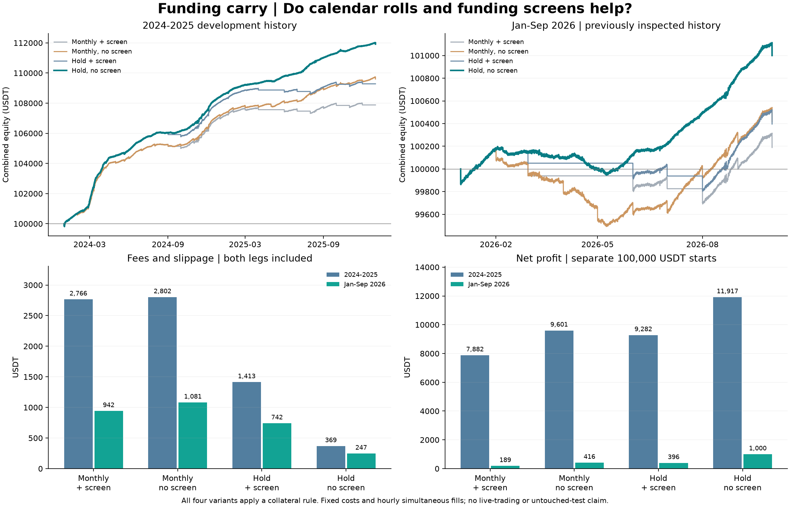

# BTC funding carry

Can a simple hedge retain more funding income by avoiding unnecessary trades?

This Python study buys BTC spot and shorts the same BTC quantity in a USDT perpetual. It compares monthly resets with holding positions, with and without a funding screen. All four rules include collateral controls and can reduce both legs together.

## Results

Each window starts separately with **100,000 USDT total capital**, including spot, collateral and entry costs. All figures include final closing costs. [USDT](https://support.wallet.tether.io/hc/en-us/articles/26232242940316-Tether-USDt-USD) is a dollar-pegged token, not US dollar cash.

| Rule | 2024–2025 costs | 2024–2025 net P&L | Jan–Sep 2026 costs | Jan–Sep 2026 net P&L |
|---|---:|---:|---:|---:|
| Monthly + screen (old version) | 2,765.75 | 7,881.66 | 942.12 | 189.21 |
| Monthly, no screen | 2,802.21 | 9,601.47 | 1,081.34 | 415.76 |
| Hold + screen | 1,413.37 | 9,282.42 | 741.52 | 395.80 |
| Hold, no screen (current) | 368.86 | 11,916.98 | 246.77 | 1,000.18 |

All amounts are USDT. All four rules had zero conservative collateral flags in these samples. This is not a guarantee against liquidation or other losses.



What changed:

- **Less trading left more net income.** Without the screen, holding reduced 2024–2025 costs by 86.8%, from 2,802.21 to 368.86 USDT. In 2026, net profit rose from 415.76 to 1,000.18, although funding receipts fell from 1,484.72 to 1,237.03 USDT.
- **The screen did not earn its place.** It reduced net profit under both execution methods in both windows. All four results are reported; no parameter search was used for this revision.
- **The return is still modest.** The current rule returned 11.92% over two years (5.79% annualised), and 1.00% over the nine-month 2026 window. Doubling all assumed fees and slippage left 752.46 USDT in 2026. This sensitivity is not proof of future profitability.

Holding keeps the existing quantity; monthly resets resize and realise the whole perpetual position. This changes later funding receipts too, so the profit difference is not a pure fee saving on identical exposure.

**Both windows had already been examined before this revision. These are retrospective comparisons, not a new untouched test or live performance.** The original monthly results remain in `results.json`; current comparisons are under `revision`.

## Rules and accounting

The current rule enters at the first available month-start, 01:00 UTC, and keeps the matched quantity without reinvesting unrealized profits. The optional screen projects the preceding seven days of funding over the coming month and compares it with round-trip costs. It uses only events strictly before month-start 00:00, then enters or exits at 01:00. Future funding is unknown.

For persistent positions, at daily 00:00, including month-start, derivative mark equity below 25% of short mark notional triggers a paired reduction at 01:00. Monthly variants use the same check between rolls, but reset collateral at the scheduled month-start roll instead. Selling spot supports the remaining short. The signal-time target is derivative mark equity of 50% of remaining spot value; the delay can leave the executed ratio away from target. No outside cash is added.

- Funding cash flow: `quantity × settlement mark × settled rate`.
- Short realized P&L: `closed quantity × (entry price − close price)`.
- Remaining short unrealized P&L: `remaining quantity × (entry price − current price)`.
- Total equity: `spot value + derivative wallet + unrealized short P&L`.

Realizing a profit moves it into the wallet without counting it twice. Generated ledgers record cash, unrealized P&L and trades separately. Monthly report segments do not imply monthly trades.

Costs are fixed assumptions: spot 10 bps, perpetual 5 bps, plus 2 bps slippage per leg, on entries, reductions and exits. The cost stress doubles all three. Actual fee tiers, fee assets, market impact and minimum order sizes are not reconstructed.

The collateral diagnostic uses the hourly mark high, all negative funding in that hour and a hypothetical 1% maintenance floor. It checks possible breaches rather than reconstructing exchange liquidation. Flagged paths are labelled unconstrained paper paths. Cash yield is zero; exchange default, USDT depeg and automatic deleveraging are excluded.

Funding and spot-sale proceeds immediately enter one model derivative wallet. Real balance and transfer constraints are simplified. Both legs fill simultaneously; execution delays are excluded. Returns scale proportionally with capital in this model, but trading capacity is untested.

## Reproduce

```sh
python3 -m venv .venv
source .venv/bin/activate
pip install -r requirements.txt
python -m unittest -v
python study.py --download --holdout
```

Python 3.11+ is required. With cached inputs, run `python study.py --holdout`. The flag retains its old name; 2026 is previously inspected history. First download requires access to Binance's archive and futures API; regional restrictions or changed source files can prevent reproduction. The 32 synthetic tests run offline.

`carry.py` holds the ledger and trading rules; `study.py` loads data and runs comparisons. Tests cover funding timing, future-data isolation, partial realization, collateral reductions, screen exits and cash conservation.

[Binance public data](https://github.com/binance/binance-public-data) supplies hourly BTCUSDT spot, perpetual and mark OHLC. Exact funding times and settlement marks come from the official funding API, cross-checked against archives. The two grids have 17,546 and 6,554 rows, including context and exit rows; December funding is warm-up only. Missing mark bars on 29 June 2026 come from the official daily archive, without interpolation. Raw files, checksums and ledgers are saved under ignored `.cache/`. Changed normalized-data hashes require review and `--accept-revised-data`.

Mechanics: [perpetual contracts and funding](https://www.binance.com/en/support/faq/detail/360033525031), [partial closing](https://www.binance.com/en/support/faq/detail/0b3a91eea664402f812fe41358c8a206), [P&L formulas](https://www.binance.com/en/support/faq/detail/360036498511), [trading fees](https://www.binance.com/en/support/faq/detail/360033544231). The motivation also draws on [Schmeling, Schrimpf and Todorov, *Crypto Carry*](https://www.bis.org/publ/work1087.pdf); perpetual funding is variable, unlike locked expiry convergence. [A public funding scanner](https://github.com/aoki-h-jp/funding-rate-arbitrage) informed the cost comparison, not the performance claims.

Data attribution: Binance Vision, retrieved 18 October 2026. Data and derived outputs are subject to the [dataset terms](https://github.com/binance/binance-public-data/blob/master/TERMS_AND_CONDITIONS.md), including CC BY-NC-SA 4.0. The normalized data and calculated outputs are modifications of those inputs. Raw vendor files are excluded from the public project.
